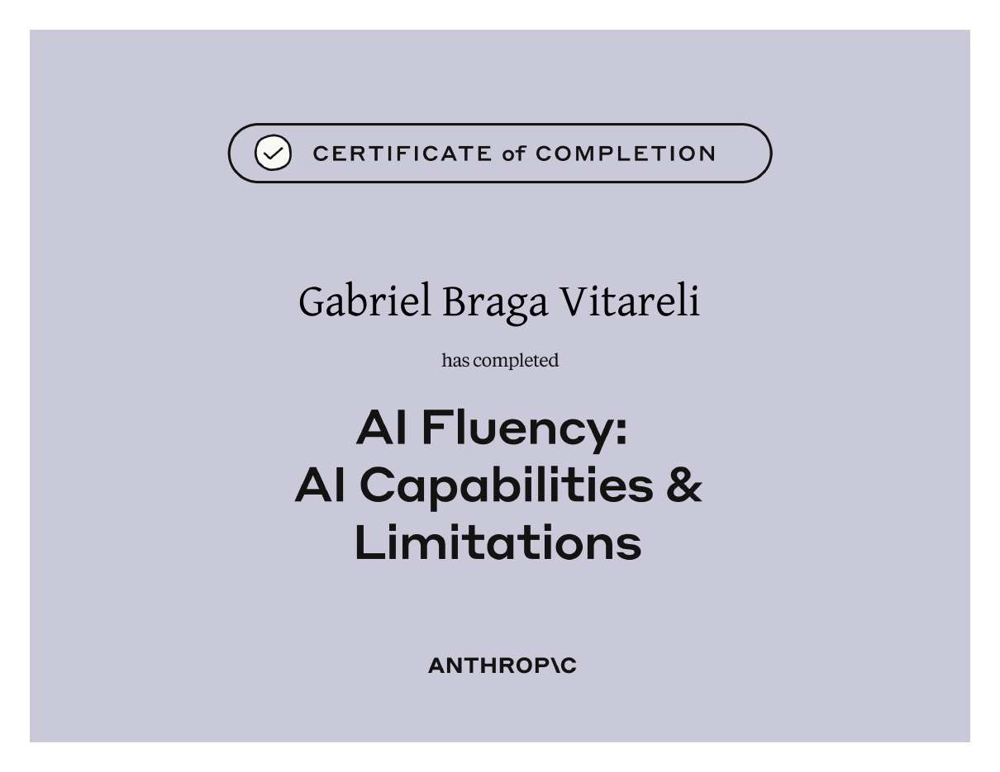
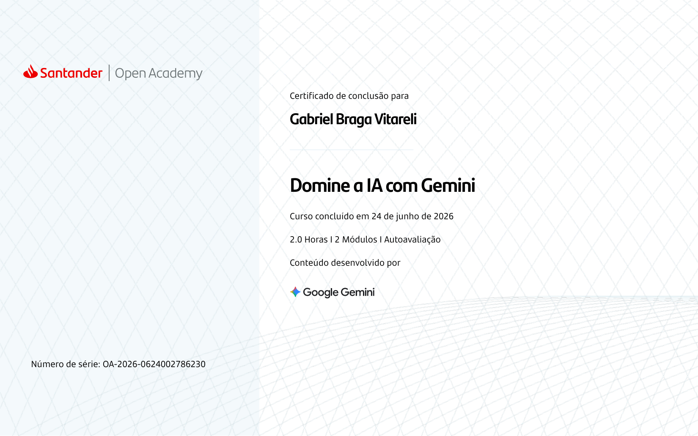
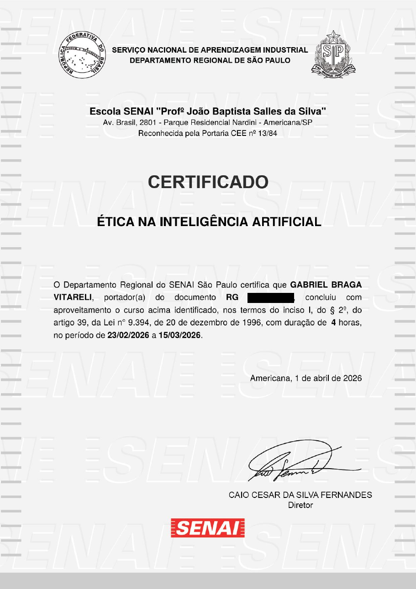
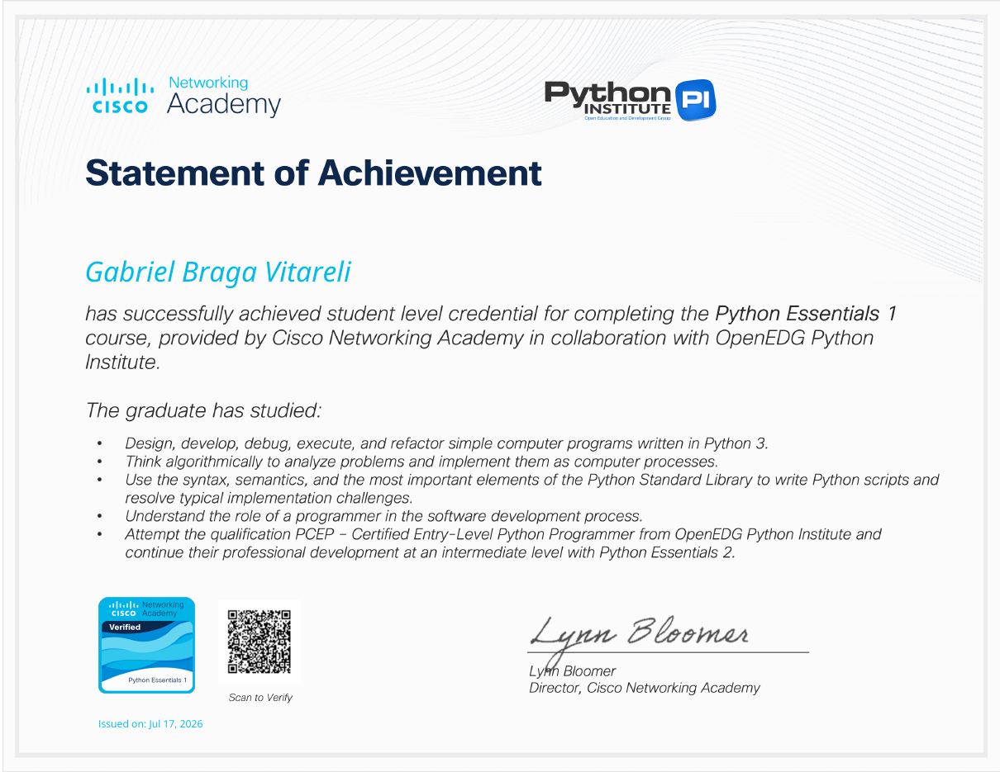
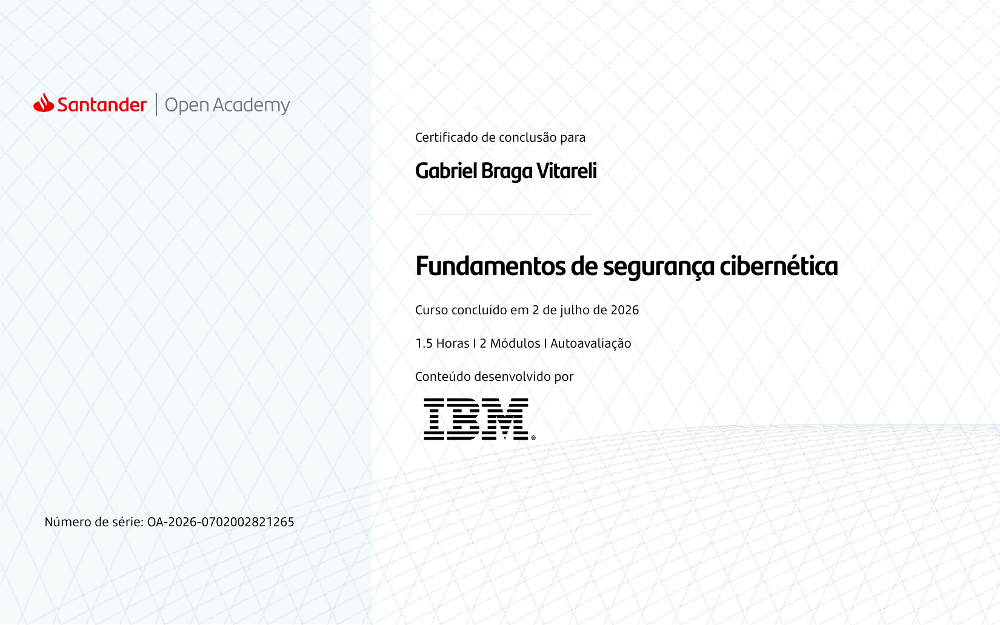
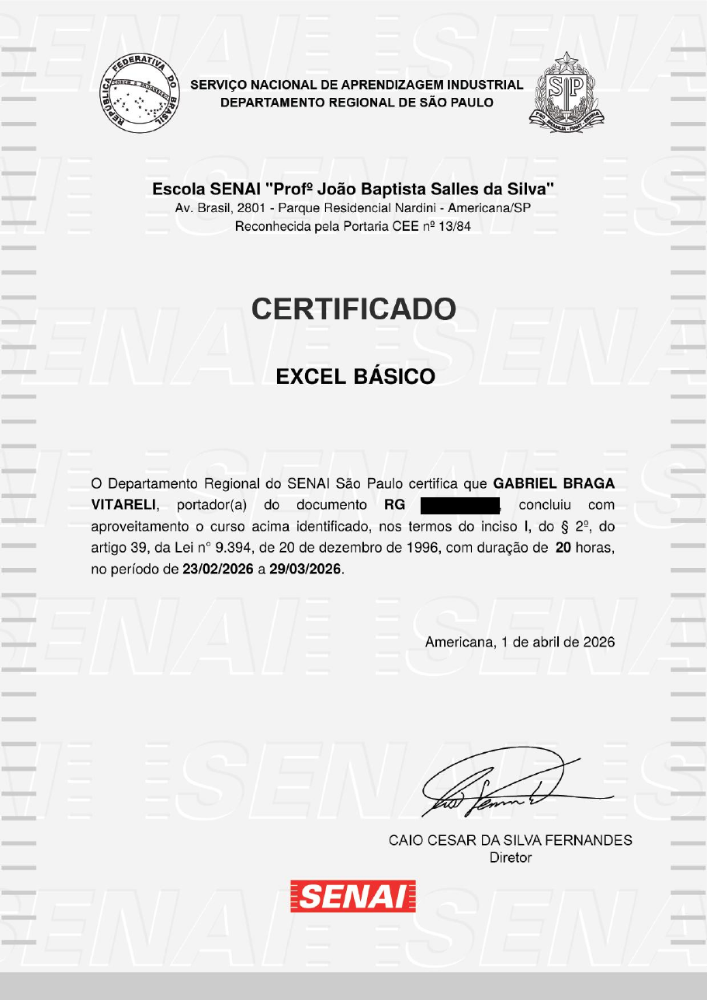
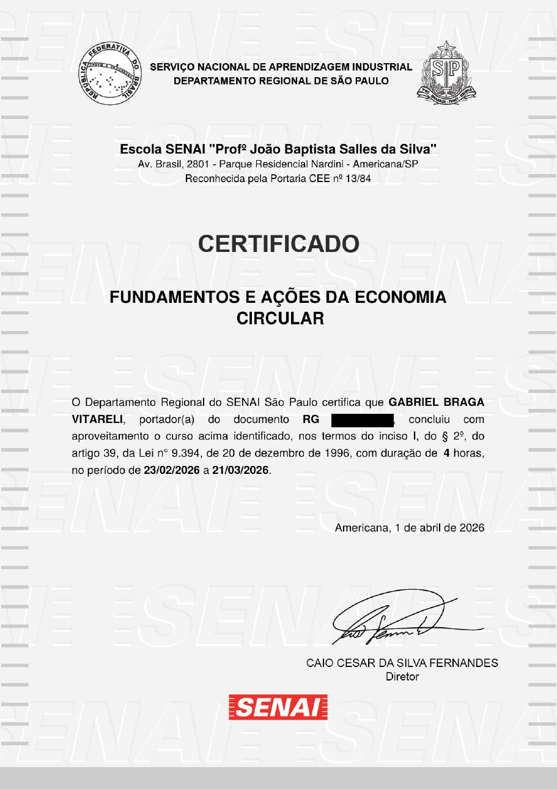

 

Cursos e certificações que conquistei ao longo da minha jornada.

Clique em qualquer certificado para abrir o PDF completo.

  

---

## `01` — INTELIGÊNCIA ARTIFICIAL

<table>
<tr>

<td width="33%" valign="top" align="center">

  
<b>AI Fluency: AI Capabilities & Limitations</b>
 
Anthropic
</td>

<td width="33%" valign="top" align="center">

  
<b>Domine a IA com Gemini</b>
 
Santander Open Academy · Google Gemini 2h · 24/06/2026
</td>

<td width="33%" valign="top" align="center">

  
<b>Ética na Inteligência Artificial</b>
 
SENAI São Paulo 4h · 23/02/2026 a 15/03/2026
</td>

</tr>
</table>

---

## `02` — PROGRAMAÇÃO E TECNOLOGIA

<table>
<tr>

<td width="33%" valign="top" align="center">

  
<b>Python Essentials 1</b>
 
Cisco Networking Academy · Python Institute 17/07/2026
</td>

<td width="33%" valign="top" align="center">

  
<b>Fundamentos de segurança cibernética</b>
 
Santander Open Academy · IBM 1h30 · 02/07/2026
</td>

<td width="33%" valign="top" align="center">

  
<b>Excel Básico</b>
 
SENAI São Paulo 20h · 23/02/2026 a 29/03/2026
</td>

</tr>
</table>

---

## `03` — FORMAÇÃO COMPLEMENTAR

<table>
<tr>

<td width="33%" valign="top" align="center">

  
<b>Fundamentos e Ações da Economia Circular</b>
 
SENAI São Paulo 4h · 23/02/2026 a 21/03/2026
</td>

<td width="33%" valign="top" align="center">

  
<b>Segurança no Trabalho</b>
 
SENAI São Paulo 14h · 23/02/2026 a 17/03/2026
</td>

<td width="33%"></td>

</tr>
</table>

---

<code>MAIS CERTIFICADOS EM BREVE</code>

 

